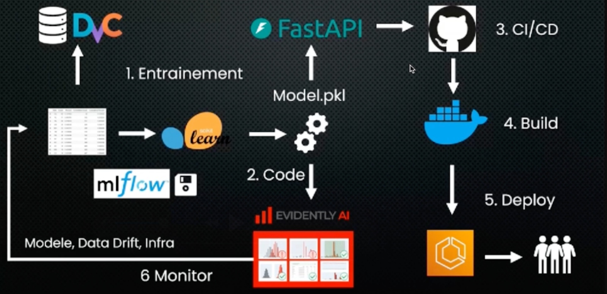

# Projet MLOps : classification d'Iris

Projet d'IA de bout en bout qui suit le cycle MLOps complet :
**données versionnées → entraînement suivi → API → CI/CD → Docker → déploiement → monitoring → ré-entraînement**.



## Les 6 étapes du pipeline

| # | Étape | Outil | Fichier |
|---|-------|-------|---------|
| 1 | Versionnage des données + pipeline | **DVC** | [`dvc.yaml`](dvc.yaml), [`src/prepare_data.py`](src/prepare_data.py) |
| 1 | Entraînement du modèle → `model.pkl` | **scikit-learn** | [`src/train.py`](src/train.py) |
| 1 | Suivi des expériences (paramètres, métriques, modèle) | **MLflow** | [`src/train.py`](src/train.py) |
| 2 | API de prédiction | **FastAPI** | [`app/main.py`](app/main.py) |
| 3 | Intégration et déploiement continus | **GitHub Actions** | [`.github/workflows/ci-cd.yml`](.github/workflows/ci-cd.yml) |
| 4 | Conteneurisation | **Docker** | [`Dockerfile`](Dockerfile) |
| 5 | Déploiement | **Hugging Face Spaces** (SDK Gradio, offre gratuite) | job `deploy` du workflow, [`space_app.py`](space_app.py) |
| 6 | Monitoring de la dérive des données | **Evidently AI** | [`src/monitor.py`](src/monitor.py) |

**Boucle de retour (6 → 1)** : l'API enregistre chaque requête dans `logs/predictions.csv`.
Evidently compare ces données de production aux données d'entraînement. En cas de dérive,
on relance `dvc repro` pour ré-entraîner le modèle, puis un `git push` redéploie automatiquement.

## Lancer le projet en local

```bash
python -m venv .venv
.venv\Scripts\activate          # Windows  (Linux/Mac : source .venv/bin/activate)
pip install -r requirements-dev.txt

dvc repro                        # prepare -> train -> monitor
dvc metrics show                 # précision du modèle
mlflow ui                        # interface MLflow sur http://127.0.0.1:5000
pytest -v                        # tests

uvicorn app.main:app --reload    # API sur http://127.0.0.1:8000  (Swagger : /docs)
```

Rapport de dérive Evidently : `reports/drift_report.html`

### Avec Docker

```bash
docker build -t iris-mlops-api .
docker run -p 7860:7860 iris-mlops-api   # http://localhost:7860
```

## Utiliser l'API

```bash
curl -X POST http://localhost:7860/predict -H "Content-Type: application/json" \
  -d '{"sepal_length":5.1,"sepal_width":3.5,"petal_length":1.4,"petal_width":0.2}'
# {"prediction":0,"class_name":"setosa","probabilities":{...}}
```

## Workflow CI/CD

À chaque `git push` sur `main`, GitHub Actions :
1. installe les dépendances et exécute `dvc repro` (données, entraînement, rapport Evidently) ;
2. lance les tests (`pytest`) : l'API doit répondre et la précision doit être ≥ 90 % ;
3. construit l'image Docker et la teste ;
4. déploie sur Hugging Face Spaces. L'offre gratuite ne propose que le SDK Gradio : le Space
   exécute [`space_app.py`](space_app.py), qui sert la même API FastAPI avec une interface
   Gradio montée sur `/gradio`.

Configuration nécessaire dans **Settings → Secrets and variables → Actions** du dépôt GitHub :
- secret `HF_TOKEN` : jeton Hugging Face avec droit d'écriture ;
- variable `HF_SPACE` : `<utilisateur-hf>/iris-mlops-api`.

## Structure

```
├── .github/workflows/ci-cd.yml   # CI/CD
├── app/                          # API FastAPI + page web
├── src/
│   ├── prepare_data.py           # données
│   ├── train.py                  # entraînement + MLflow
│   └── monitor.py                # Evidently
├── tests/                        # tests pytest
├── dvc.yaml / dvc.lock           # pipeline DVC
├── params.yaml                   # hyperparamètres
├── Dockerfile
└── requirements*.txt
```
